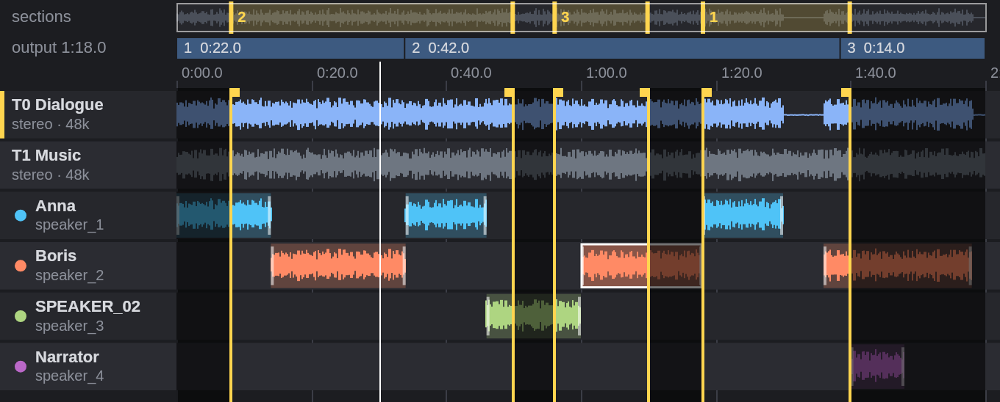

# ComfyUI MultiTrack Audio

**One node, "Audio Timeline": see an audio/video file (or the output of a Load Audio node) on a timeline, choose
the parts you want, find the speakers, fix them like in an editor, and get one audio output per speaker. Optionally
save everything as a multi-track `mka`/`mov`.**


*(a rendering of the timeline from the test data; the real node looks like this inside ComfyUI)*

ComfyUI's built-in loaders only ever read the *first* audio stream. This node shows all tracks of a file, can use
them as outputs, and can split a dialogue into speakers.

## The timeline

| Row | What it is |
|---|---|
| **sections** (top bar) | the whole file with the parts you keep (yellow), numbered in output order |
| **output** | the kept sections in the order they are joined, with their lengths and the total |
| ruler | time; drag here to mark a new section |
| **T0, T1, …** | every audio track of the file (waveform, channels, rate) |
| speaker lanes | one per speaker: their **clips** (where they talk), drawn on the waveform |

### Sections: what goes into the output (and the analysis)
- **Mark** a part: drag on the ruler. The first one replaces "the whole file"; drag more to add others.
- **Trim**: drag a section's edge (on the lanes, the ruler or the top bar).
- **Re-order**: drag a block in the *output* strip left/right. The output is the sections joined in that order.
- **Cut**: click the ruler to place the playhead, then **✂ Split**. **Delete** removes the selected section
  (delete them all and you are back to the whole file).

### Speakers and clips: fix the analysis
- **Analyze speakers** detects who talks when, only inside the kept sections.
- **Trim a clip**: drag its edge. **Draw** a clip: drag in an empty part of a speaker's lane.
- **Reassign**: drag a clip onto another speaker's lane (it overwrites what that speaker had there).
- **Add a speaker** by hand: **+ Speaker**, then draw its clips. **− Speaker** removes the selected lane.
- Double-click a name to rename. Click a lane and **▶ Play** to hear one track or one speaker, through the sections.
- **Undo / Redo** (Ctrl+Z / Ctrl+Shift+Z with the timeline focused) cover every edit.
- Wheel = zoom, drag on a track = pan, double-click = fit.

A clip says *where in the source* a speaker talks; dragging it sideways doesn't move audio. To change the order of
the audio itself, re-order the sections.

## Input
- **A file**: choose it in *audio* (or **Upload**, or paste a full path into *file_path_override*). The timeline
  appears immediately. *track_index* (or a click on a track lane) picks the track that is analysed and used as `timeline`.
- **A Load Audio node**: connect it to *audio_in*, queue the workflow **once**, and the audio appears on the timeline
  (it is cached; after a ComfyUI restart run it once more). *audio_in* wins over the file.

## Outputs (they appear as you add lanes)
`timeline`, `segments`, `saved_paths`, then **one output per lane**: `speaker_1`, `speaker_2`, … as many as there are
speakers on the timeline (or, in "tracks of the file" mode, as many as the file has other tracks). Only existing lanes
have an output; one that is connected is never removed. The node can have up to 16.

- `timeline`: the kept sections joined (nothing cut = the source itself, sample for sample).
- `speaker_N`: that speaker's speech on the same timeline, silent elsewhere, exactly as long as `timeline`.
- `segments`: the clips as JSON, in *output* time. `saved_paths`: the file written, if any.

**speakers_from**: `detected speakers` (the lanes you see and edit) or `tracks of the file`: no analysis, the file's
*other* tracks come out as `speaker_N` unchanged (e.g. an export with a dialogue track plus one track per speaker).
The sections apply to every track equally.

## Saving (optional)
`save_format`: `none (preview only)` (default), `mka` or `mov`: **one audio stream per track** (the timeline first,
then each lane, named after the speakers). WAV and MP3 can't hold several tracks, so they aren't offered.

The size is set by **`save_bit_depth`** (16 / 24 / 32-bit float) and **`save_sample_rate`** (source, or 8000 …
96000): bitrate = rate × bits × channels. The line under the buttons estimates it, e.g.
for a one-minute program `Save mka: 16-bit · 22.05 kHz · mono ≈ 353 kbps per track · 3 tracks ≈ 7.9 MB`. *save_mono* (advanced) mixes tracks to mono.

## The length never changes
Whatever you save or play, **the duration is not altered**:
- with nothing cut, `timeline` is the source sample for sample and every lane has exactly its length;
- with sections, the output is exactly the sum of the sections; each lane has that length;
- a different save sample rate changes the number of samples, not the duration (tests check this for every
  format × bit depth × rate combination); tracks are never padded or stretched.

**Channels vs tracks.** A *track* is a separate audio stream (mov/mka); *channels* (stereo, 5.1, …) live inside one
track. ComfyUI's own Preview/Save Audio nodes write all channels of an `AUDIO` into one stereo stream, so audio with
more than two channels plays back 2–3× too slow there. That was the "slowed down" output: this node therefore mixes
more than two channels to mono by default (`multichannel`, advanced: `keep all channels` leaves them).

## Install
```bash
cd ComfyUI/custom_nodes
git clone https://github.com/YOUR_NAME/ComfyUI-MultiTrackAudio
python -m pip install -r ComfyUI-MultiTrackAudio/requirements.txt   # ComfyUI's own Python
```
Restart ComfyUI and **hard-reload the page** (the timeline is a frontend extension). The node is *Audio Timeline* in
`audio`. Needs PyAV (`av`), `numpy`, `soundfile` (tested with PyAV 15.1, 16.1, 19.0).

### Speaker detection (optional, needed for *Analyze*)
1. `python -m pip install -r requirements-diarization.txt` (installs `pyannote.audio`; **check pip's output**, it may
   want to change your `torch`).
2. Accept the conditions of [`pyannote/speaker-diarization-community-1`](https://huggingface.co/pyannote/speaker-diarization-community-1)
   on Hugging Face and create an access token.
3. Download it once (Windows portable example, adjust paths):
```bat
python_embeded\python.exe ComfyUI\custom_nodes\ComfyUI-MultiTrackAudio\tools\download_model.py --token hf_xxxxxxxx
```
It lands in `ComfyUI/models/pyannote/speaker-diarization-community-1` and is found there automatically, offline. To use a
copy elsewhere, type its folder (the one with `config.yaml`) into `model`. There is deliberately no token field, so tokens
can't leak into shared workflows (or use `HF_TOKEN` / `huggingface-cli login`).

## Example workflows
`example_workflows/` (ComfyUI: **Workflow → Browse Templates**, or drag a file on):
1. `01_load_audio_to_speakers`: Load Audio → Audio Timeline → previews
2. `02_file_edit_and_save_multitrack`: straight from a file, saved as a small `mka`
3. `03_tracks_of_the_file`: a file that already has separate tracks

## Notes
- Waveforms and in-node playback use a cached 16 kHz mono copy of each track; the node *outputs* are the real audio.
- Only the first track is analysed; the analysis downmixes it to mono.
- Overlapped speech: with `exclusive` on (pyannote.audio ≥ 4) it goes to one speaker; you can also fix it by hand.
- `advanced` inputs (model, speaker limits, padding, fade, multichannel, save_mono, …) are normal rows in the classic
  canvas and sit behind the advanced toggle in Nodes 2.0.

## Troubleshooting
- **No timeline / node missing:** the folder must be `ComfyUI/custom_nodes/ComfyUI-MultiTrackAudio/` with `__init__.py`
  directly inside (unzipping often nests it); restart ComfyUI, hard-reload the page, look for `IMPORT FAILED`. The browser
  console (F12) shows `[MultiTrackAudio]` errors.
- **Audio is slowed down:** see *Channels vs tracks*; keep `multichannel` on `mix`.
- **"Model folder not found" / model can't load:** see *Speaker detection*; the message names a lost backslash when it can.
- **`maximum recursion depth` while loading the model:** a speechbrain bug with `python_embeded`; patched automatically.
- **Play is silent:** browsers start audio only after a click; press Play again.
- **Connected audio doesn't show:** queue the workflow once.

## Limitations
- At most 16 lane outputs. Lossless PCM only for saving. No MXF/AAC/FLAC/Opus.
- Clips and sections are edited in the browser; the run uses exactly what the timeline shows (stored in the workflow).
- Tracks are held in RAM as float32 (about 11 MB per mono minute at 48 kHz).

## Development
```bash
pip install numpy av soundfile pytest
python -m pytest tests -q                   # Python: core, API helpers, node, workflows
node --test tests/js/timeline.test.mjs      # JS: the timeline editor model (no dependencies)
python tools/build_example_workflows.py     # regenerate example_workflows/ after changing node inputs
```
`web/lib/timeline.js` is the pure editor model + renderer, `web/mta_timeline.js` the ComfyUI glue. Tests stub `torch` /
`folder_paths` when ComfyUI isn't present. Never put `{"audio_upload": True}` on a file combo (it makes the frontend
inject a widget that crashes node creation); `tests/test_node_defs.py` guards that.

## Changelog
- **0.3.0** – Editing: several **sections** (mark, trim, split, delete, re-order), **editable speaker clips** (trim, draw,
  reassign, add speakers by hand), Undo/Redo. **audio_in** for a Load Audio node. **Dynamic outputs** (one per lane).
  Multi-track files (track choice, "tracks of the file") and **saving** are back, as `mka`/`mov` only, with bit depth and
  sample rate and a size estimate. Fixed the slowed-down/lengthened audio (more than 2 channels); durations are now
  guaranteed and tested. **Breaking:** inputs/outputs changed (outputs: timeline, segments, saved_paths, speaker_N…).
- **0.2.0** – One node with a timeline replaces the eight separate nodes.
- **0.1.x** – Separate nodes; model path fixes, speechbrain workaround.

## License
MIT
